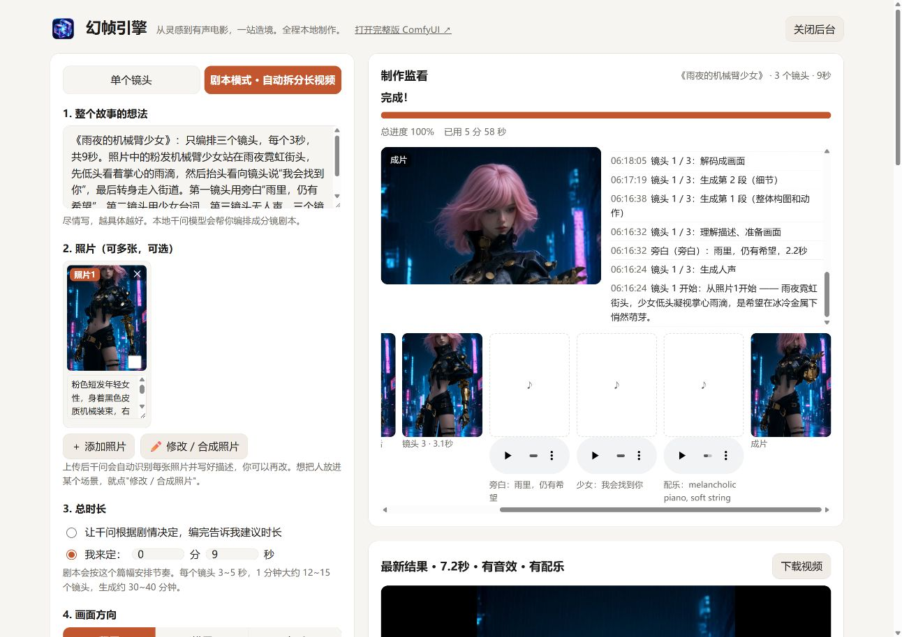
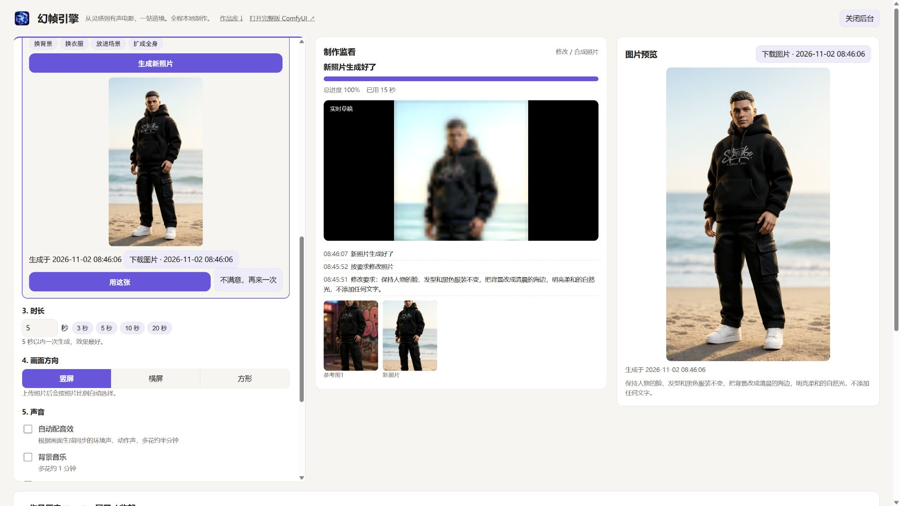

<h1 align="center">幻帧引擎 · Huanzhen Engine</h1>

用几秒一个的镜头，在本地拍完一段有声故事。

<a href="#设计">设计思路</a> · <a href="#安装">安装与核对</a> · <a href="https://github.com/wuqiwuxin5757/huanzhenyinqing/archive/refs/heads/main.zip">下载源码</a>

幻帧引擎是一个基于 ComfyUI 的本地视频创作工作台。它解决的是短视频模型很擅长拍一个动作，却很难在一次生成里完成一整段剧情的问题。你可以从一个故事想法开始，先编排分镜，再逐个生成、检查和接拍，最终合成带人声、音效和配乐的短片。

*实际工作台中的《雨夜的机械臂少女》演示。创作输入、制作进度和生成素材都在同一页。*

## 设计

### 一次只拍一个动作

故事可以交给本地编剧模型拆成 3 或 5 秒的镜头，也可以直接用原文手动建镜头。每个镜头各有自己的动作描述、起始方式和声音。比如「抬头看见街灯」和「转身走入小巷」分开拍，下一段就能收到自己的动作指令。成片下方也可以展开检查各段用过的原文。

### 连续动作接末帧，换场时重新起镜

同一场景要接着拍时，把前一段的最后一帧提取出来，交给下一段作为起始图。切换视角或场景时，可以从新的照片起镜，也可以直接从文字起镜。需要明确落点的镜头还可以选择结束照片，让模型在起始和结束画面之间生成过程。拼接时，续接段会跳过用于衔接的第一帧，独立起镜则保留首帧。

### 把重试范围缩到一个片段

单镜头模式连续生成多段时，可开启「逐段预览再接拍」。满意就用它的末帧继续，动作不合适就只改这一段重试，也可以先保存已经确认的部分。如果现有成片已经出现偏差，预览里可选时间截断，从最后一帧可用画面接拍成一个新作品。末帧能传递构图和姿态，长链路里仍可能出现人物或动作漂移，所以工作台留出了重新起镜和人工确认的入口。

### 用实际时间轴对齐声音

旁白、台词、环境音和配乐分别处理。拼接根据实际帧率和片段时长计算起点，统一不同镜头的帧率和音轨格式，补齐没有声音的区段，再把旁白和配乐放到成片时间轴上。需要核对画面变化时，也可以选择保留基础生成、高清放大和补帧后的文件。

查看更多界面 · 素材编辑与制作监看

## 安装

项目是 ComfyUI 的扩展。开发和验证环境为 Windows 便携版 [ComfyUI v0.43.0](https://github.com/Comfy-Org/ComfyUI/tree/426f5eea52a7ece1dd599fff4cb6cd1f352ddd24)，使用本机模型。可先安装基础图生视频，其他功能按需配置。

1. 在 ComfyUI 根目录运行 `git clone https://github.com/wuqiwuxin5757/huanzhenyinqing.git custom_nodes/huanzhen-engine`。用 ZIP 下载时，将内容解压到同一位置，确保该目录直接包含 `__init__.py`。
2. 在 ComfyUI 的 Python 环境中安装此仓库的 `requirements.txt`。便携版可从便携根目录运行 `python_embeded\python.exe -m pip install -r ComfyUI\custom_nodes\huanzhen-engine\requirements.txt`。
3. 安装 [ComfyUI-GGUF](https://github.com/city96/ComfyUI-GGUF)，本机使用的提交为 `6ea2651`。遵循该扩展的依赖安装说明，把 Wan 2.2 相关文件按 [模型清单](models.required.json) 放进 `ComfyUI/models`。图生和文生分别使用 `i2v` 和 `t2v` 组。
4. 在便携根目录运行 `python_embeded\python.exe ComfyUI\custom_nodes\huanzhen-engine\check_setup.py --comfy-root ComfyUI --feature i2v`。启动 ComfyUI 后追加 `--url http://127.0.0.1:8188`，还可检查扩展入口与所需节点是否加载。
5. 打开 `http://127.0.0.1:8188/easy`。上传一张自备照片，选择 3 秒，填写简单动作，例如「镜头缓缓推近，树叶随风轻摆」。首次验证可以先关闭旁白、配乐、音效、放大和补帧。

`check_setup.py` 会列出缺失的文件或节点，并返回非零退出码。使用文生视频时改为 `--feature t2v`，可以多次传入 `--feature` 检查不同功能。检查不运行推理，显存需求和成片质量仍取决于模型、分辨率及机器配置。

可选功能使用对应的本地模型和节点。旁白使用 [ComfyUI-Qwen-TTS](https://github.com/flybirdxx/ComfyUI-Qwen-TTS) 的 Qwen3-TTS VoiceDesign，对口型还需要 InfiniteTalk，音效使用 [ComfyUI-MMAudio](https://github.com/kijai/ComfyUI-MMAudio)，配乐使用 ACE-Step，放大使用 SeedVR2，补帧使用 FILM，照片编辑使用 Qwen-Image。请按照各第三方项目文档安装其附加依赖及权重。整套能力依赖的具体节点可以在 [工作流代码](page/index.html) 中核对。

剧本编排和自动描述照片需要放在便携根目录旁的 `llama.cpp`。当前配置从它的 `bin` 目录启动 `llama-server.exe`，从 `models` 目录加载 `Qwen3VL-8B-Instruct-Q8_0.gguf` 和 `mmproj-Qwen3VL-8B-Instruct-F16.gguf`。没有配置编剧模型时，仍可用「用原文建镜头」手动编排。

如需 Windows 桌面启动方式，把 [portable-launcher](portable-launcher) 里的文件复制到便携根目录下的 `easy_app`，双击 `launcher.vbs`。也可以创建指向它的桌面快捷方式并选用随附图标。

模型、第三方扩展和 ComfyUI 需分别准备。作品和临时参考素材存放在安装环境的输入、输出目录。作品回收目录为 `ComfyUI/output/easy/.trash`。
